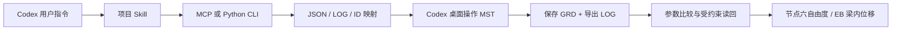

# MST Codex Bridge

[](LICENSE)

**A Codex Skill with a Python CLI and MCP server for structural MST2008.** Create and edit model inputs, guide visible desktop solving, validate native exports, and recover Euler–Bernoulli beam displacement fields. Includes synthetic examples and verification summaries. Requires a separately installed, licensed MST application for GUI solving; no headless solver or vendor API is bundled.

面向空间结构软件 MST2008 的本地文件桥接原型。Codex 可以创建和修改结构参数，通过 MCP 或 CLI 生成 MST 输入，配合可见桌面操作求解，再核验与导出节点结果。

工作流分成 **MCP 文件层 + Codex 桌面操作层**。Python 负责确定性数据处理，MST 负责求解，Codex 的 computer-use 工具负责当前界面操作。未公开的 COM、命令行求解器或 GRD 二进制写入接口不在本包能力内。



## 当前能力

|操作|实现与边界|
|---|---|
|inspect / validate|模型数量、单位、ID、连接关系、几何/荷载有效性|
|create / edit|按稳定 ID 创建、增加、替换、删除节点/杆/材料/截面/支座/工况；整体校验后写新目录|
|prepare|生成 LOG、映射、材料设置单和 GUI 操作说明；不自动求解|
|compare|比较导出的节点、连接、截面、支座、荷载和实际 E/G/ν/重量密度|
|ingest|公开 LOG 的节点六自由度导出；可选配对 GRD 高精度受约束读取|
|recover|用 EB 梁形函数恢复杆内位移；核验模型与高精度结果绑定，输出采样极值标记|

写入适配支持刚接梁、单材料 class0、CHS/RHS/I、全固定六自由度支座、一个恒载槽和一个活载组。材料数值修改需要 GUI 确认并读回；非零截面角度和其他未验证特性会被拒绝。RHS 的软件扭转刚度与闭口管物理参考值存在差异，须显式接受后才能输出。具体约定见 [接口说明](docs/interface.md)。

本次未检索到经核实可直接采用的 MST2008 专用 Skill/MCP，详见 [检索记录与来源](docs/discovery.md)。当前代码可复用，本机 GUI 适配经验不能保证所有 MST 版本行为一致。

## 安装与运行

准备 Python 3.11 或以上、Git；执行真实求解还需 Windows 上可用的 MST2008 和支持桌面操作的 Codex 环境。仅文件处理和自动化测试不需要 MST。下列命令使用 PowerShell：

```powershell
git clone https://github.com/JenniferYFZHAO/mst-codex-bridge.git
Set-Location mst-codex-bridge
python -m venv .venv
& .\.venv\Scripts\python.exe -m pip install -e '.[test]'
& .\.venv\Scripts\python.exe -m mst_codex_bridge.cli validate examples/cantilever.json
& .\.venv\Scripts\python.exe -m mst_codex_bridge.cli prepare examples/cantilever.json work/run_001
```

`.venv` 为独立环境；Windows 上官方 MCP SDK 可能带入 pywin32 传递依赖，本包没有用它进行 GUI 操作。`requirements-tested.txt` 记录本次实测依赖版本，跨系统重新安装时按 pyproject.toml 解析平台依赖。

修改为 4 m、2 kN：

```powershell
& .\.venv\Scripts\python.exe -m mst_codex_bridge.cli edit examples/cantilever.json examples/edit_4m_2kN.json work/edit_001
& .\.venv\Scripts\python.exe -m mst_codex_bridge.cli prepare work/edit_001/model.json work/run_002
```

读取作业内 `GUI_STEPS.md`，在新建空白 MST 模型中导入，完成材料设置、另存、验算不调整、保存 GRD 和导出 LOG。完整 LOG 重复导入已有模型会累加荷载；即使节点和杆数不变，也不能当成覆盖更新。导出假定为 `work/run_001/native.grd` 与 `work/run_001/native.log`：

```powershell
& .\.venv\Scripts\python.exe -m mst_codex_bridge.cli compare work/run_001 work/run_001/native.log work/check_001
& .\.venv\Scripts\python.exe -m mst_codex_bridge.cli ingest work/run_001/native.log work/result_001 --grd work/run_001/native.grd --mapping work/run_001/mapping.json --case RESDEADLOAD --job work/run_001 --comparison work/check_001/comparison.json
& .\.venv\Scripts\python.exe -m mst_codex_bridge.cli recover work/run_001/model.json work/result_001/RESDEADLOAD_displacements.csv work/beam_001
```

每次输出使用新目录。CLI 与 MCP 均限制读写路径位于 `--workspace` 下，并解析路径穿越/符号链接；源模型和已有输出不覆盖。`inspect` 与 `ingest` 可以处理原项目的大模型 LOG/GRD；旧节点映射 CSV 支持列 `source_node_id,mst_node_id`，空 MST ID 跳过。原大模型的写入迁移须保留截面方向等信息，本版未承诺把它无损转换为当前受限 JSON。

批量表格输入见 `scripts/import_tables.py --help`：提供节点 CSV、杆件 CSV，以及材料/截面/支座/荷载定义 JSON。字段不做猜测，避免把既有工程文件中的局部轴、释放等信息静默丢弃。

## Codex 如何调用

项目 Skill 位于 [skills/mst-codex/SKILL.md](skills/mst-codex/SKILL.md)。先完成上面的克隆和依赖安装，再在仓库根目录执行以下命令，将技能装到本项目；已有同名技能时命令会停止，方便先比较内容：

```powershell
New-Item -ItemType Directory -Force .agents/skills | Out-Null
if (Test-Path .agents/skills/mst-codex) { throw '同名 Skill 已存在，请先比较内容。' }
Copy-Item -Recurse skills/mst-codex .agents/skills/mst-codex
```

在 Codex 中打开这个仓库并新建会话，输入：

> 请使用 $mst-codex 检查 examples/cantilever.json，生成新的 MST 作业，再通过可见界面求解、核对参数并导出结果。

也可以让 Codex 的 Skill 安装器从 `JenniferYFZHAO/mst-codex-bridge` 的 `skills/mst-codex` 安装到用户技能目录。**单独安装 Skill 不会安装 Python 后端**，仍需克隆本仓库并安装依赖。在其他研究工作区使用时，向 Codex 明确后端仓库绝对路径，或在启动 Codex 前设置当前终端环境变量 `$env:MST_CODEX_BRIDGE_ROOT` 指向该路径。该变量用于 Skill 定位后端，不会改变 MCP 的工作区范围。

MCP 为可选入口，以下注册步骤需在克隆仓库的根目录执行，会修改 Codex MCP 配置；仅使用 CLI 时可以跳过：

```powershell
$bridgeRoot = (Get-Location).Path
$bridgePython = Join-Path $bridgeRoot '.venv\Scripts\python.exe'
codex mcp add mst-file-bridge -- $bridgePython -m mst_codex_bridge.server --workspace $bridgeRoot
```

注册并在新会话确认工具出现后，可用 `mst_create`、`mst_edit`、`mst_prepare` 等九个工具。当前已验证官方客户端通过 stdio 调用这些工具；这不意味着正在运行的 Codex 会话已热加载服务器。MCP 未注册时使用 CLI 可以完成同样文件操作。

## 验证与使用范围

```powershell
& .\.venv\Scripts\python.exe -m pytest -q
& .\.venv\Scripts\python.exe scripts/verify_mcp.py --out work/mcp_check_001.json
```

`tests/` 的 27 项测试通过，覆盖 ID 映射、力与轴矢量转换、参数误差识别、修改保留原文件、非法结构拒绝、路径限制、浮点数组歧义和梁场解析校核。`verify_mcp.py` 实际启动服务器子进程，完成协议握手、工具列表、九个工具成功调用与三个错误调用。其二进制 fixture 是人工数组，不代表真实 GRD 文件格式。

两组真实 MST GUI 端到端验证均已完成：3 m/1 kN 悬臂下挠 20.8690891 mm，修改为 4 m/2 kN 后为 98.9349442 mm，与解析解最大差约 0.00001031 mm。另将重复导入导致荷载累加的真实错误成功拦截；大型原模型的 20664 个结果分量与既有验证读取器一致。见 [验证摘要](verification/README.md)。4 m 合成算例保留软件超应力提示，接口验证通过与设计验算通过分别记录。

独立审查促成两项数据校验：位移必须绑定相同模型，粗精度 LOG 转角不能直接用于定量梁场。`ingest` 通过 job 和 comparison 回执绑定模型/输入/映射/原生 LOG；`recover` 再检查 CSV 散列和高精度来源。节点结果仍可单独导出用于人工查看，未绑定数据不能自动进入梁场恢复。

`compare PASS` 只证明指定参数在导出中匹配；`ingest PASS` 只证明读回满足完整性/精度约束；梁挠度为形函数恢复。输出统一保留 `training_label_release=false`。后续研究需按具体模型设置材料、荷载、物理假定和独立力学验证门槛。

## 开源范围与贡献

本项目按 [MIT License](LICENSE) 开源，见 [第三方组件说明](LICENSE_STATUS.md)。发布范围限源代码、Skill、合成示例、公开链接和去标识验证摘要；商业程序、软件手册、原工程模型、研究论文、真实工程结果与 `.venv/work` 均排除。软件名称用于说明兼容目标，本项目独立开发，未获得 MST 厂商的官方接口认证。

欢迎通过 [Issues](https://github.com/JenniferYFZHAO/mst-codex-bridge/issues) 提交版本信息、可公开的最小合成例及实际/预期结果，或通过 Pull Request 增加经过验证的适配。提交前运行 pytest 与 `scripts/verify_mcp.py`；涉及 GUI 的改动应记录软件版本、导入设置和参数读回依据。请勿上传许可证密钥、原工程模型、个人路径或商业软件文件。

`scripts/pack_source.py --out <新的zip路径>` 使用白名单生成源码归档及逐文件 SHA-256 清单，既不打包工作目录，也不执行发布。当前版本为 v0.1.0 研究原型；其他 MST 安装环境、更多单元与边界类型仍需独立验证。
